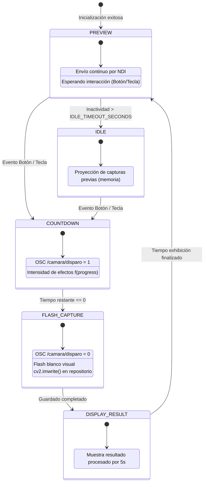

# AGENT.md / Architecture Specification

Este documento describe la especificación técnica formal de **abismo-core** para desarrolladores de sistemas y agentes de Inteligencia Artificial (IAs de asistencia de código).

---

## 1. Visión General del Sistema
**abismo-core** es una aplicación monolítica liviana orientada a eventos y procesamiento de flujo de cuadros (*frame loop*), diseñada para estaciones interactivas de arte digital.

Opera bajo el paradigma de **Hardware Abstraction Layer (HAL)**: desacopla completamente el procesamiento visual y la interacción lógica de la plataforma subyacente (macOS, Windows x86_64 o Linux aarch64 en Raspberry Pi 4).

---

## 2. Diagrama de la Máquina de Estados Finita (FSM)

El ciclo de ejecución principal está orquestado por un enum `AppState` dentro de `main.py`:



---

## 3. Protocolos de Red y Streaming

### A. Protocolo NDI (Network Device Interface)
* **Objetivo:** Inyectar el video continuo de la cámara en vivo a la red local sin compresión perceptible y con latencia sub-cuadro.
* **Consumidores:** Software de procesamiento visual en tiempo real en la sala (**TouchDesigner** y **OBS**).
* **FourCC:** `BGRX` / `BGRA` a resolución configurada en `config.CAPTURE_WIDTH` / `HEIGHT`.
* **Modo Tolerante (Dry-Run):** Si `NDIlib` no se encuentra compilado para el sistema anfitrión, el módulo emite una advertencia en `stdout` y conmuta a modo seguro sin abortar la aplicación.

### B. Protocolo OSC (Open Sound Control)
* **Objetivo:** Señalización de eventos de disparo a computadoras externas (PC 3 Central y servidores de videoproyección / mapping).
* **Transporte:** UDP Unicast a `config.OSC_RECEIVER_IP` : `config.OSC_RECEIVER_PORT`.
* **Dirección y Payload:**
  * Dirección: `/camara/disparo`
  * Tipo: Entero (`int32`)
  * `1`: Inicio del conteo (el visitante pulsó el botón).
  * `0`: Fin del conteo / Disparo de la fotografía.

---

## 4. Estándar de Contrato para el Pipeline de Efectos

El subsistema de efectos (`effects/`) implementa el patrón de diseño **Chain of Responsibility**:

```python
class BaseEffect(ABC):
    def __init__(self, name: str, enabled: bool = True):
        self.name = name
        self.enabled = enabled

    @abstractmethod
    def apply(self, frame: np.ndarray, face_data: Optional[Dict[str, Any]], progress: float) -> np.ndarray:
        pass
```

### Invariantes del Pipeline:
1. **Preservación de dimensiones:** El array retornado por `apply()` debe tener estrictamente la misma resolución (`shape`) y tipo (`uint8`) que el `frame` de entrada.
2. **Inmutabilidad opcional:** Si el efecto no puede aplicarse (ej. no hay rostro detectado para un efecto dependiente de cara), debe retornar el `frame` intacto sin generar excepciones.
3. **Control por `progress`:** `progress` varía en el intervalo $[0.0, 1.0]$. Los efectos estáticos pueden ignorarlo; los efectos progresivos deben usarlo como factor escalar de deformación.

---

## 5. Directrices para Agentes de Código e IAs
- **Modificación de Efectos:** Únicamente añadir o alterar clases dentro del paquete `effects/`. Registrar en `main.py`.
- **Modificación de Hardware:** Alterar exclusivamente `modules/camera.py` o `modules/input_btn.py`. No acoplar llamadas específicas de GPIO o V4L2 en `main.py`.
- **Configuraciones:** Parámetros como IPs, dimensiones, puertos y timeouts deben residir exclusivamente en `config.py` o ser leídos de variables de entorno.
